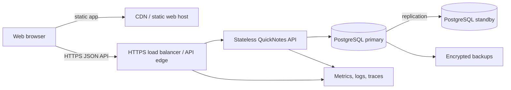

# QuickNotes architecture

## Requirements

### Functional

- Register, authenticate, and log out users.
- Create, view, search, edit, tag, and delete a user's notes.
- Keep notes private to their owner and support pagination.
- Validate title and body input and return actionable errors.

### Non-functional

- Protect credentials and data in transit and at rest.
- Keep common note operations responsive and available through routine
  instance or zone failures.
- Back up durable data and test restoration.
- Scale API instances horizontally and observe latency, errors, and saturation.
- Support accessible web use on desktop and mobile devices.

## Initial sizing estimates

These are planning assumptions, not measured production traffic:

| Measure | Initial assumption |
| --- | --- |
| Registered users | 100,000 |
| Monthly active users | 20,000 |
| Notes per active user | 100 |
| Average note payload | 2 KiB |
| Stored note content | About 4 GiB raw at 2 million notes, before indexes/replicas |
| Average API traffic | About 10 requests/second |
| Peak API traffic | About 100 requests/second |
| Availability target | 99.9% monthly for the API |
| Latency target | p95 under 300 ms for ordinary CRUD requests |

At 100 peak requests/second and 10x headroom, begin with several stateless API
instances, connection pooling, and a managed PostgreSQL primary with a
same-region standby. Revisit sizing using measured payload sizes, query latency,
and growth; these figures do not justify an early microservice split.

## High-level diagram

## Components

- **Browser and static host:** Deliver the accessible web client. Static assets
  can be cached at a CDN; API calls use the versioned API origin.
- **HTTPS load balancer/API edge:** Terminates TLS, applies request-size and
  rate limits, routes requests, and adds a request ID. It must not make
  authorization decisions based on untrusted client-supplied user IDs.
- **Stateless API instances:** Validate tokens and input, enforce ownership,
  coordinate transactions, and return the documented error envelope. Multiple
  instances can scale independently.
- **PostgreSQL:** Stores accounts, notes, tags, and associations with foreign
  keys and transactions. The primary handles writes; a standby can be promoted
  during a primary failure. Read replicas are optional if measured read load
  warrants their replication-lag trade-off.
- **Backups and observability:** Encrypted point-in-time recovery backups
  protect against operator/data-loss events. Central metrics, structured logs,
  and traces carry request IDs without logging secrets or note contents.

## Request flows

### Read notes

1. The browser sends `GET /v1/notes` with an access token and optional cursor.
2. The edge validates basic request limits, forwards the request, and assigns
   or propagates a request ID.
3. The API validates the token, derives the user ID from it, validates query
   parameters, and queries only that user's notes.
4. PostgreSQL returns an ordered page; the API serializes the items and next
   cursor; the browser renders the response.

### Create or update a note

1. The browser sends JSON with the access token.
2. The API validates the title/body and verifies referenced tags belong to the
   same user.
3. A database transaction writes the note and any tag associations.
4. The API returns the saved representation (`201` for create, `200` for
   update); validation and ownership errors use the documented error envelope.

### Delete a note

1. The browser sends `DELETE /v1/notes/{noteId}`.
2. The API scopes the delete by both authenticated user ID and note ID.
3. PostgreSQL cascades note-tag associations and commits; the API returns
   `204 No Content`, after which the browser removes the item.

## Trade-offs and evolution

- Start with a modular monolith rather than microservices: note operations and
  tag changes benefit from simple transactions, and early service boundaries
  would add deployment and network complexity.
- Use PostgreSQL and cursor pagination for consistency and stable ordering.
  Offset pagination is simpler but can skip/repeat items as notes change and
  gets slower at large offsets.
- Cache static assets at the CDN. Do not cache private note responses at a
  shared edge by default; personalized caching risks leaking data.
- Add a read replica, full-text index, or asynchronous jobs only after
  measurements identify a bottleneck. Replicas improve read capacity but can
  return stale data.
- Use access tokens with short lifetimes and a revocable refresh/session
  mechanism. Secure, HTTP-only cookies can reduce token exposure to script
  access but require CSRF protections; the client/server deployment model
  should choose one explicitly.

## Single points of failure

The initial deployment still has critical dependencies: the PostgreSQL
write-primary, the API edge, and the identity/token signing configuration.
Mitigate the database-primary risk with a managed multi-zone standby, automated
health-based failover, point-in-time recovery, and regular restore/failover
drills. Run API instances and the edge across multiple zones and keep API
instances stateless. Back up signing keys securely and document rotation and
recovery; key loss can invalidate sessions. A standby does not protect against
logical corruption replicated from the primary, so independent backups are
required. During a database outage, fail closed for private data and return
`503 SERVICE_UNAVAILABLE` rather than serving another user's or stale
unverified data.
