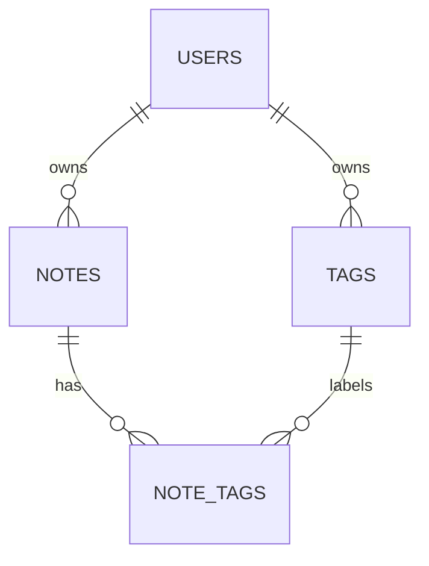

# QuickNotes data model

## Entities and relationships

The relational model has four entities:

1. **User** owns notes and tags.
2. **Note** belongs to exactly one user.
3. **Tag** belongs to exactly one user.
4. **NoteTag** is the join entity connecting notes and tags. A note can have
   many tags and a tag can be applied to many notes.

Deleting a user cascades to that user's notes, tags, and note-tag associations.
Deleting a note or tag cascades only to its associations. The composite
`(note_id, tag_id)` key prevents duplicate associations.



## PostgreSQL schema

```sql
CREATE TABLE users (
    id              UUID PRIMARY KEY DEFAULT gen_random_uuid(),
    email           TEXT NOT NULL UNIQUE,
    password_hash   TEXT NOT NULL,
    created_at      TIMESTAMPTZ NOT NULL DEFAULT now(),
    updated_at      TIMESTAMPTZ NOT NULL DEFAULT now()
);

CREATE TABLE notes (
    id              UUID PRIMARY KEY DEFAULT gen_random_uuid(),
    user_id         UUID NOT NULL REFERENCES users(id) ON DELETE CASCADE,
    title           VARCHAR(100) NOT NULL,
    body            TEXT NOT NULL DEFAULT '',
    created_at      TIMESTAMPTZ NOT NULL DEFAULT now(),
    updated_at      TIMESTAMPTZ NOT NULL DEFAULT now(),
    CONSTRAINT notes_title_not_blank CHECK (length(btrim(title)) > 0),
    CONSTRAINT notes_body_size CHECK (octet_length(body) <= 200000)
);

CREATE TABLE tags (
    id              UUID PRIMARY KEY DEFAULT gen_random_uuid(),
    user_id         UUID NOT NULL REFERENCES users(id) ON DELETE CASCADE,
    name            VARCHAR(50) NOT NULL,
    created_at      TIMESTAMPTZ NOT NULL DEFAULT now(),
    CONSTRAINT tags_name_not_blank CHECK (length(btrim(name)) > 0),
    CONSTRAINT tags_user_name_unique UNIQUE (user_id, name)
);

CREATE TABLE note_tags (
    note_id         UUID NOT NULL REFERENCES notes(id) ON DELETE CASCADE,
    tag_id          UUID NOT NULL REFERENCES tags(id) ON DELETE CASCADE,
    created_at      TIMESTAMPTZ NOT NULL DEFAULT now(),
    PRIMARY KEY (note_id, tag_id)
);
```

The schema uses the PostgreSQL `pgcrypto` extension for `gen_random_uuid()`:

```sql
CREATE EXTENSION IF NOT EXISTS pgcrypto;
```

The API's 50,000-character body limit is also validated in application code;
the database constraint is a defensive storage bound. All note queries must
include the authenticated `user_id`, not just the note ID.

## Indexes

```sql
CREATE INDEX notes_user_updated_idx
    ON notes (user_id, updated_at DESC, id DESC);

CREATE INDEX notes_user_created_idx
    ON notes (user_id, created_at DESC);

CREATE INDEX tags_user_name_idx
    ON tags (user_id, name);

CREATE INDEX note_tags_tag_note_idx
    ON note_tags (tag_id, note_id);
```

The unique constraints already index `users.email`, `(tags.user_id, tags.name)`,
and the `note_tags(note_id, tag_id)` primary key. The additional reverse join
index supports listing notes by tag. Add a PostgreSQL full-text search index
over `title` and `body` if production query measurements show text search needs
it; avoid maintaining an unused index.

## Example queries

Create a note for an authenticated user:

```sql
INSERT INTO notes (user_id, title, body)
VALUES ($1, $2, COALESCE($3, ''))
RETURNING id, title, body, created_at, updated_at;
```

List the newest notes for a user using a stable cursor:

```sql
SELECT id, title, body, created_at, updated_at
FROM notes
WHERE user_id = $1
  AND (
      $2::timestamptz IS NULL
      OR (updated_at, id) < ($2::timestamptz, $3::uuid)
  )
ORDER BY updated_at DESC, id DESC
LIMIT $4;
```

Load notes that have a selected user-owned tag:

```sql
SELECT n.id, n.title, n.body, n.created_at, n.updated_at
FROM notes AS n
JOIN note_tags AS nt ON nt.note_id = n.id
JOIN tags AS t ON t.id = nt.tag_id
WHERE n.user_id = $1
  AND t.user_id = $1
  AND t.id = $2
ORDER BY n.updated_at DESC, n.id DESC
LIMIT $3;
```

Update and delete must enforce ownership in the statement:

```sql
UPDATE notes
SET title = $3, updated_at = now()
WHERE user_id = $1 AND id = $2
RETURNING id, title, body, created_at, updated_at;

DELETE FROM notes
WHERE user_id = $1 AND id = $2;
```

## SQL vs. NoSQL decision

Use PostgreSQL. Users, notes, tags, and their many-to-many relationship have
clear integrity rules and ownership boundaries. Transactions are valuable when
creating a note and its tag associations, and relational constraints prevent
orphaned or cross-user data. The expected access patterns are well served by
the ownership and ordering indexes above. PostgreSQL also supports JSON fields
and full-text search if those become useful without giving up relational
consistency. A document database could make note/tag embedding easy, but would
duplicate tags and complicate consistency, sharing, and querying across a
user's data without a demonstrated scaling need.
